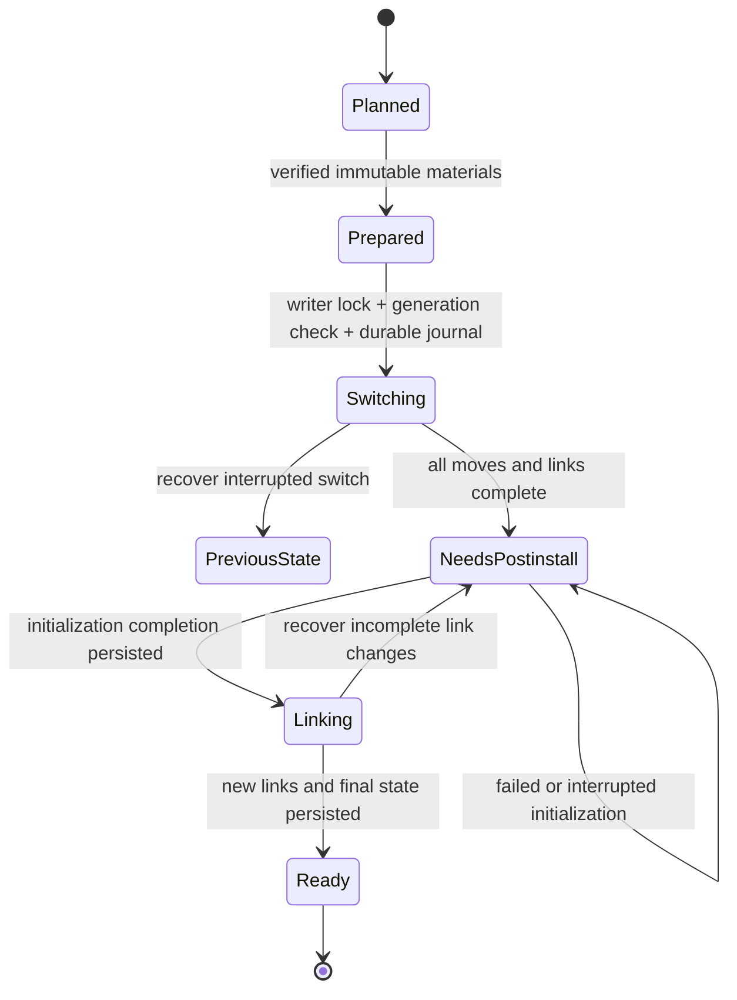

# Architecture

gobrew is a native Go client for official Homebrew core bottles. The CLI is an
adapter around an in-process engine that can later be called by MyGo.

## Dependency direction

`cli → engine → catalog / resolver / artifact / installer / state / platform`

The `model` package contains shared values, errors and bounded progress events.
The resolver is pure: no network, database, terminal or macOS calls. Interfaces
belong at real I/O boundaries, not around every concrete implementation.

| Package | Owns | Must not own |
| --- | --- | --- |
| `cli` | Arguments, JSON envelopes, signals, terminal rendering | Installation rules |
| `engine` | Typed use cases, snapshot selection, stage timing | Long-lived DB handles or UI callbacks |
| `resolver` | Version ordering, platform and dependency decisions | Filesystem/network effects |
| `catalog` | Signature verification, normalized immutable indexes | Installed-state mutations |
| `artifact` | Digest-addressed downloads, extraction, relocation, leases | Active prefix links or post-install data |
| `installer` | Kegs, owned links, config merge, operation recovery | Catalog refresh or package downloads |
| `state` | State schema, generations, journal, writer serialization | Formula semantics |
| `platform` | File cloning, process locks, durability primitives | Package policy |
| `postinstall` | Validated declarative actions and explicit command boundary | Automatic retry of unknown command outcomes |

`cmd/gobrew` contains only the process entry point. A future MyGo entry point in
this module can call `internal/engine` directly. The UI owns its event consumer
and main-thread scheduling; the engine never depends on MyGo or its lifecycle.

## Three phases

1. Plan fixes catalog generation, installed-state generation, exact bottles and
   their dependency graph. Unsupported semantics are rejected before activation.
2. Prepare downloads, verifies and materializes immutable, relocated trees.
   Neither the state database nor the prefix writer lock is held over networking.
3. Apply obtains the prefix lock, checks the plan generation, stages on the
   Cellar filesystem and commits changes through a durable journal.

Progress is best effort and nonblocking. Final outcomes are function results.
Cancellation is observed between safe filesystem transitions; it cannot abort a
half-committed link operation or replace recovery.

A `PreparedOperation` holds artifact leases and must be closed even when Apply
fails or the user abandons the plan. Applying a changed state generation returns
`ErrStalePlan`; it never silently changes selected versions. A pending filesystem
journal makes read-only planning return `ErrRecoveryRequired`. The command use
case recovers once and makes a fresh plan; a GUI can expose recovery explicitly.

## Ownership and state

The default prefix is `/opt/gobrew`, owned by one non-root user. Bootstrap may
create only this fixed missing directory; it must never recursively chown an
existing installation. Normal formula execution never runs as root.

Catalog snapshots are separate from mutable installed state. bbolt handles are
short lived because even a read-only handle holds a process-level file lock.
The future GUI must not keep a database handle open between calls.

Installed state and filesystem operation intents live in the same bbolt file.
Before changing files, persist old/new paths and link ownership. Recover an
unfinished operation before another mutation. Never delete or replace a foreign
file during rollback. Keep database syncing enabled and do not put filesystem
side effects inside retryable DB.Batch callbacks.

Packages become `needs-postinstall` before external initialization, then `ready`
only after success. Interrupted external commands are never automatically
replayed. Repair is explicit. Configuration and mutable data are not rollbackable
and are retained during uninstall. Old kegs remain until safe reclamation.

The initial switch is reversible; external initialization is a separate boundary.
An initialization-complete marker prevents rerunning a successful command merely
because publishing generated executables failed. A crash between a command's
return and that marker still has an unknown outcome and requires explicit repair.
Recovery retains completed package records and explicit-request promotions.

Writer lock order is prefix `writer.lock`, then a short bbolt open/transaction.
Preparation acquires cache tree leases in sorted key order before per-blob leases;
it acquires neither the prefix lock nor the state database. Leases may remain held
through Apply, but prefix-locked code never waits for new cache leases. Eviction
uses nonblocking lease attempts. Readers copy state before closing the DB.

Private directories and ownership markers are checked before moving or deleting
kegs; markers must be regular, singly linked files with the expected token.
Extraction cannot supply an ownership marker. Health checks follow the installed
dependency closure without hashing every file or opening the catalog.

New trees are synchronized before publication, and directory changes are synced
before committing their journal transitions. macOS device barriers preserve this
ordering; existing warm cache trees are not flushed again on lookup. This protects
gobrew's recorded filesystem boundary. It does not promise to undo or make durable
arbitrary external effects performed by third-party initialization commands.

## Dependency compatibility

Keep installed runtime dependency facts. Version ordering includes version_scheme
and revision; compatibility_version is an ABI hint, not a replacement for runtime
minimum versions. Dependency changes consider installed reverse dependents.
Pins, unavailable bottles and unsupported steps block the entire plan before
activation. Retaining old keg directories alone does not protect opt-linked users.

An older forward dependency may be reused when its version epoch and nonempty
compatibility version match the current recipe. Such reuse is explicit in
`Plan.RuntimeChecks`: Prepare must obtain a versioned minimum from every selected
direct consumer's bottle and prove the installed dependency satisfies it. Missing
evidence or an insufficient version rejects the plan before Apply, including pins;
it never silently upgrades the dependency. Explicit upgrade/reinstall roots do
not use this exception. Historical transitive facts are filtered only after
verified Mach-O linkage inspection and comparison with the current dependency
closure; directly declared and actually imported libraries remain authoritative.

## Performance and cache identity

An already-installed install is a local no-op; upgrade is explicit. Help, version
and installed queries do not load the catalog or network. Catalog refresh builds
an immutable indexed generation and atomically publishes it.

Planning reads only requested roots, every installed recipe, and their current
dependency closures in one short index transaction. Including installed recipes
preserves reverse-dependent upgrades. Unknown keys and aliases fall back to the
complete snapshot in that same transaction; search still reads the full catalog.

Downloads share a Transport and have a separate concurrency limit from CPU/disk
preparation. Blob keys are SHA-256. Prepared tree keys include the blob digest,
prefix, Cellar, platform, path mappings and relocation implementation version.
Only complete trees before post-install may enter the immutable cache. Materialize
with APFS clone, falling back to copies, never hardlinks.

The preparation key also binds formula identity, package revision, bottle tag and
rebuild. Changing relocation or extraction semantics increments its schema so old
prepared trees cannot bypass new checks. Modern bottles may omit an embedded
receipt: runtime facts then come from an official OCI index/manifest whose layer
digest must match the signed catalog bottle digest. Digest-addressed manifests
are independently checked before accepting their runtime dependency annotations.

Default budgets: 2 GiB compressed and 8 GiB prepared, measured as logical bytes.
Eviction protects active operations and happens on cache insertion or cleanup,
not no-op reads. Cache hits do not require a database write for exact LRU.
Temporary artifact names contain their cache key. Cleanup may reclaim abandoned
work only after acquiring its lease nonblockingly; active or unidentifiable
temporary entries are retained.

## Trust boundary

Verify official metadata signatures and bottle digests. Confine extraction;
reject traversal, symlink escapes, special files and unsafe metadata. Relocation
and post-install have explicit supported operations. Unknown operations fail
closed. System commands use argument arrays and controlled environments.

## Validation and distribution

Unit and filesystem tests cover dependency planning, malicious archives,
cache isolation, journal recovery, ownership and post-install interruption.
Real ARM64 smoke tests cover executable and dynamic-library behavior. Cold,
warm and no-op benchmarks are distinct and do not skip initialization. Releases
are tagged GitHub Actions builds with checksums; no GUI dependency is required.
The binary attached to a release is the same binary that passed the performance
job, rather than an unmeasured rebuild. Measurements include process wall time,
Plan/Prepare/Apply timings and logical disk usage; stage timings do not replace
the end-to-end release gate.
